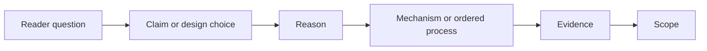

<div align="center">

# Scientific Writing

**Compile technical reasoning into scientific prose.**

[](https://github.com/WannaBSteve/scientific-writing/actions/workflows/ci.yml)
[](LICENSE)
[](SKILL.md)

English | [简体中文](README.zh-CN.md)

</div>


`scientific-writing` is an installable Agent Skill for planning, drafting,
revising, and auditing scientific manuscripts and reviewer responses. It is
especially strong on Methods, system design, algorithms, equations, cost
models, and technical evidence.

Most writing tools begin at the sentence. This skill begins one level earlier.
It reconstructs the argument the reader needs to follow, then edits the prose.

## The core idea: argument compilation

The skill turns supplied scientific content into a reader path:



For a Methods section, it first recovers the operational trace:

```text
problem -> inputs -> ordered operations -> decision -> state/output -> validation
```

This catches a common failure that grammar tools miss: every sentence can be
correct while the passage remains difficult to follow.

## What makes it different

### Reader-state continuity

Each paragraph has one reader question. The skill checks what the reader knows
at the start, what becomes clear at the end, and why the next paragraph follows.
It does not use transition words to conceal a missing reasoning step.

### Equation bridge

An equation is connected to four things: its purpose, the source of its terms,
the decision it controls, and the measurement that validates it. Notation is
introduced after the reader understands the idea.

### Citation job

A citation must do visible work. The prose states whether a source supplies a
definition, design precedent, mechanism, measurement method, comparison, or
limitation. A citation list after "follows prior work" is not enough.

### Evidence routing

Each figure and table answers one primary question. Resource accounting,
end-to-end performance, scaling, and lifecycle evidence remain separate unless
their relationship is the point of the object.

### Objection relevance

The skill retains necessary scope conditions and real limitations. It removes
sentences that answer objections the reader has not encountered. This reduces
defensive prose without hiding measured loss cases.

## A small example

Before:

> The optimizer has a private candidate state. Three advisors propose
> operations. There is a current state. The solver checks dependencies and
> resources. The candidate is measured. Requests use the current state.

After recovering the method trace:

> The optimizer processes each proposed database change in four stages. (1)
> Three advisors propose candidate operations, and the selector checks their
> dependencies, resource use, and expected value. (2) The system builds only
> the selected changes in a private state while requests continue to use the
> current state. (3) It measures the affected requests and removes operations
> that fail validation. (4) Publication makes the validated state visible to
> later requests.

The full synthetic example is in
[`examples/methods-rewrite`](examples/methods-rewrite). It is a reference
revision, not a claimed model benchmark.

## Install

### Skills CLI

```bash
npx skills add WannaBSteve/scientific-writing --global
```

### Codex

```bash
git clone https://github.com/WannaBSteve/scientific-writing.git \
  "${CODEX_HOME:-$HOME/.codex}/skills/scientific-writing"
```

Restart or open a new Codex session after installation.

### Claude Code

```bash
git clone https://github.com/WannaBSteve/scientific-writing.git \
  ~/.claude/skills/scientific-writing
```

### Project-local installation

Clone the repository into the skill directory recognized by your Agent Skills
host. The repository root is the skill root and contains `SKILL.md`.

## Use

Plain-language requests work when the host supports automatic skill discovery:

```text
Use $scientific-writing to revise this Methods section. Reconstruct the method
trace before editing sentences. Preserve every measurement and citation.
```

```text
Use $scientific-writing to audit the equations in this section. Check purpose,
term provenance, operational decision, and measured validation.
```

```text
Use $scientific-writing to rewrite this reviewer response. Answer each request
in order and connect every claim to a manuscript change or result.
```

The skill has five modes:

| Mode | Output |
|---|---|
| Plan | section contract, argument map, evidence needs |
| Draft | new evidence-bounded prose |
| Revise | restructured copy-ready prose |
| Audit | prioritized, located findings |
| Respond | reviewer response with changes and evidence locations |

The user can request a narrow operation. The skill does not expand a paragraph
edit into a full-manuscript audit.

## Report-only prose auditor

The repository includes a deterministic helper for mechanical signals:

```bash
python3 scripts/audit_prose.py path/to/section.tex
python3 scripts/audit_prose.py --format json path/to/section.md
```

It reports long sentences, dense punctuation, staged phrases, generic citation
lead-ins, unresolved LaTeX references, and equations with no nearby purpose
statement. It never rewrites the file and does not claim to detect AI
authorship.

## Behavior evaluations

Six synthetic cases test the distinctive decisions:

- reconstruct a method trace;
- bridge an equation to its decision;
- give a citation a concrete job;
- remove unraised objections from a reviewer response;
- split mixed evidence by question;
- leave a clean control passage alone.

Validate the assets with:

```bash
python3 scripts/check_eval_assets.py
```

The cases are rubrics for isolated agent runs. Asset validation does not prove
writing quality. See [`evals/README.md`](evals/README.md).

## Development

```bash
make validate
make test
make audit-example
```

The CI workflow checks skill metadata, internal links, tests, eval assets, and
the clean-control audit. See [CONTRIBUTING.md](CONTRIBUTING.md) before proposing
a behavioral change.

## Repository map

```text
SKILL.md                         Entry workflow and routing
references/                     Task-specific writing protocols
scripts/audit_prose.py          Report-only surface auditor
evals/                          Synthetic behavior cases and rubrics
examples/methods-rewrite/       Full before/evidence/after example
tests/                          Deterministic tests
agents/openai.yaml              Codex UI metadata
```

## Scope

The skill does not provide plagiarism detection, AI-authorship detection,
automatic citation verification, statistical analysis, or acceptance
prediction. It does not invent evidence or upload manuscripts. Source research
is a separate task and requires an authorized research tool.

## License and citation

Released under the [MIT License](LICENSE). Citation metadata is available in
[`CITATION.cff`](CITATION.cff). The repository was informed by public Agent
Skill packaging patterns without copying their prose or code. See
[`THIRD_PARTY_NOTICES.md`](THIRD_PARTY_NOTICES.md).
