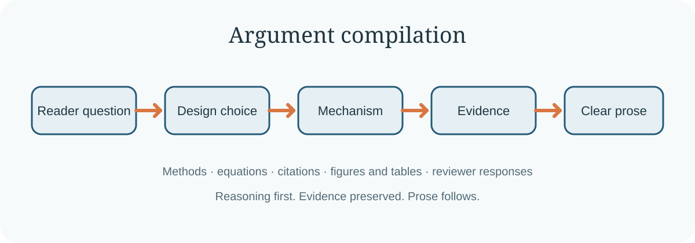

<div align="center">

# Scientific Writing

**先编译技术论证，再写科研文字。**

[](https://github.com/WannaBSteve/scientific-writing/actions/workflows/ci.yml)
[](LICENSE)
[](SKILL.md)

[English](README.md) | 简体中文

</div>



`scientific-writing` 是一个可安装的 Agent Skill，用于规划、撰写、修改和
审查科研论文及审稿回复。它特别强化 Methods、系统设计、算法、公式、成本
模型和技术证据的表达。

很多写作工具从句子开始。本技能先处理更核心的一层：恢复读者需要沿着什么
推理路径才能理解方法，然后才修改文字。

## 核心方法：argument compilation

技能会先把已有科研内容整理成：

```text
读者问题
  -> 结论或设计选择
  -> 理由
  -> 机制或有序过程
  -> 证据
  -> 适用范围
```

对于 Methods，它首先恢复真实的方法轨迹：

```text
问题 -> 输入 -> 有序操作 -> 决策 -> 状态或输出 -> 验证
```

这能发现普通语法工具无法发现的问题：每句话可能都是正确的，但整段依然无法
顺畅理解。

## 与普通写作技能的区别

### Reader-state continuity

每一段只回答一个读者问题。技能检查读者在段落开始时知道什么，段末新增了
什么，以及下一段为什么自然出现。它不会用过渡词掩盖缺失的逻辑关系。

### Equation bridge

每个重要公式需要连接四部分：公式目的、每一项的数值来源、公式控制的决策，
以及后续测量或验证。读者先理解问题，再接触符号。

### Citation job

引用必须承担明确工作。文字要说明引用提供的是定义、设计先例、机制、测量方法、
比较结果还是局限。只在“follows prior work”后面堆引用不能完成设计解释。

### Evidence routing

每个表和图只回答一个主要问题。资源开销、端到端性能、扩展性和生命周期证据
不会因为使用同一个 workload 就被强行混在一起。

### Objection relevance

技能保留解释 claim 所需的范围条件和真实局限，同时删除读者尚未提出的问题。
这会减少防御性写作，但不会隐藏负面结果。

## 安装

使用 Skills CLI：

```bash
npx skills add WannaBSteve/scientific-writing --global
```

安装到 Codex：

```bash
git clone https://github.com/WannaBSteve/scientific-writing.git \
  "${CODEX_HOME:-$HOME/.codex}/skills/scientific-writing"
```

安装后重新打开一个 Codex 会话。

安装到 Claude Code：

```bash
git clone https://github.com/WannaBSteve/scientific-writing.git \
  ~/.claude/skills/scientific-writing
```

## 使用示例

```text
使用 $scientific-writing 修改这个 Methods 章节。先恢复方法执行顺序，再修改
句子。保留全部测量数字和引用。
```

```text
使用 $scientific-writing 审查本节公式。检查公式目的、每一项的来源、公式控制
的决策以及实测验证。
```

```text
使用 $scientific-writing 重写这段审稿回复。按审稿意见的顺序回答，并把每个
判断对应到论文修改或实验结果。
```

技能支持五种模式：

| 模式 | 输出 |
|---|---|
| Plan | 章节职责、论证图和所需证据 |
| Draft | 基于已有证据的新文字 |
| Revise | 重组后的可直接使用文字 |
| Audit | 带位置和修改方法的问题列表 |
| Respond | 对应论文修改和证据位置的审稿回复 |

## 只报告、不自动改写的检查工具

```bash
python3 scripts/audit_prose.py path/to/section.tex
python3 scripts/audit_prose.py --format json path/to/section.md
```

它检查过长句子、标点密度、铺垫式短语、没有具体作用的引用表达、LaTeX
引用错误，以及缺少目的说明的公式。它不会修改文件，也不声称检测 AI 作者身份。

## 行为评测

仓库包含六个合成案例，分别检查方法顺序、公式解释、引用作用、审稿回复、
图表职责和 clean control。运行：

```bash
python3 scripts/check_eval_assets.py
```

这个命令只验证评测材料是否完整，不代表模型行为已经通过。详见
[`evals/README.md`](evals/README.md)。

## 开发

```bash
make validate
make test
make audit-example
```

## 范围

本技能不提供抄袭检测、AI 作者检测、自动引用真实性验证、统计分析或录用预测。
它不会编造证据，也不会上传论文。文献检索属于独立任务，需要经过授权的研究工具。

## 许可证

本项目使用 [MIT License](LICENSE)。引用信息见 [`CITATION.cff`](CITATION.cff)。
仓库借鉴了公开 Agent Skill 项目的组织经验，但没有复制其文字或代码。详见
[`THIRD_PARTY_NOTICES.md`](THIRD_PARTY_NOTICES.md)。
